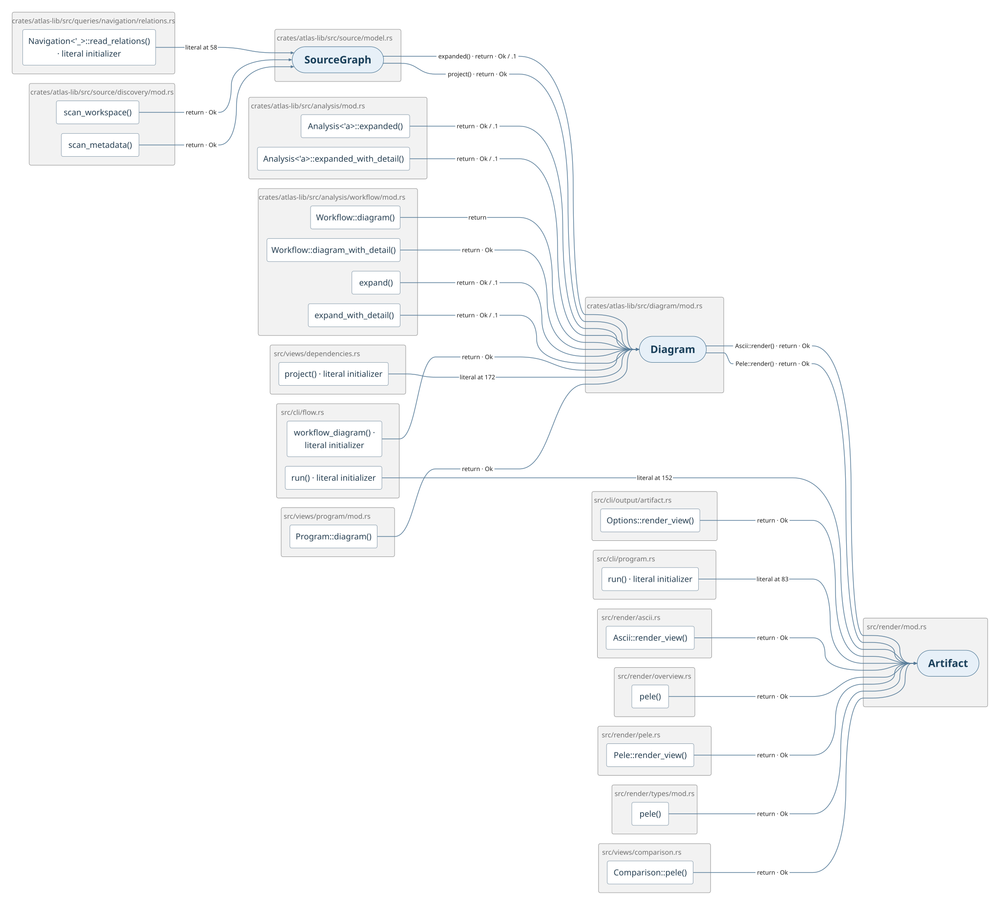

# Atlas

Atlas answers questions about how your Rust codebase is put together, and it
can stop a change that breaks the structure you agreed on.

You point it at a Cargo project and ask, from your terminal, a script or CI:

- Where is this type defined, and how much of the code depends on it?
- I just refactored a lot of files. What actually changed?
- Which files call into which?
- Does this change break our architecture rules?

Atlas only reads your code. It never edits, compiles or runs it, and every
answer points to the file and line it came from, so you can check it yourself.

## What it looks like

### Draw how your types move through the code

Choose some types, and Atlas draws every function that takes, returns or builds
them, grouped by the file each function lives in. Here is Atlas drawing its own
three central types:

```console
$ cargo atlas types --query examples/queries/atlas.json --panel contracts --as svg --bare
```

<!-- To refresh: run the command above once with --theme dark and once with
     --theme light, each with --out target/atlas/contracts-THEME.svg, and copy both
     into docs/images/. -->
<a href="https://raw.githubusercontent.com/flowerornament/atlas/main/docs/images/contracts-light.svg">
  <picture>
    <source media="(prefers-color-scheme: dark)" srcset="https://raw.githubusercontent.com/flowerornament/atlas/main/docs/images/contracts-dark.svg">
    
  </picture>
</a>

Every arrow is a function signature or a place where the type is built. Click
the image for full size.

### Find a type, and see how much depends on it

Here is Atlas looking at its own source:

```console
$ cargo atlas name Snapshot
Snapshot: 2 declaration sites (ambiguous), and 2 impl blocks

crates/atlas-lib/src/source/discovery/mod.rs:39:Snapshot [pub struct]
  Source bytes and their derived lexical graph from one discovery pass.
  4 outgoing, 45 incoming candidate-unique, 0 incoming ambiguous
  pub struct Snapshot {

src/adapter/snapshot.rs:27:Snapshot [pub struct]
  2 outgoing, 4 incoming candidate-unique, 0 incoming ambiguous
  pub struct Snapshot {

(and the two `impl Snapshot` blocks)
```

There are two different types named `Snapshot`. About 45 places refer to the
first and 4 to the second, so you know which one a change would ripple
through. When a name could mean more than one thing, Atlas shows you every
match. It never picks one for you.

### See what a big change really did

You moved code across files and renamed things. The text diff shows hundreds
of changed lines. Atlas compares every function and type body with the earlier
commit and sorts them:

```console
$ cargo atlas moved HEAD~4
Token bodies against d3e4e42d4a95…: 1186 exact; 0 rerooted; 10 changed; 0 only before; 0 only after
changed: atlas method Comparison::text · src/views/comparison.rs:271
changed: atlas-lib item header_counts · crates/atlas-lib/src/checks/concentration/ratchets.rs:559
...
```

Out of 1,196 items, 1,186 are identical apart from where they live or how
they're formatted. You only need to review the 10 that changed.

### See which files depend on which

```console
$ cargo atlas dependencies --relation calls
...
RELATIONSHIPS
  [main.rs] --calls: main calls check (1 site)--> [check.rs]
  [main.rs] --calls: main calls parse (1 site)--> [parse.rs]
...
  - 0 outside-scope observations retained in evidence; 11 unresolved/external call observations are not proved absent.
```

Calls Atlas could not follow are counted, not dropped.

Add `--as svg` to draw the same thing as an SVG image. Atlas can also
draw which functions produce and consume a type, and every path a function can
take. See [diagrams](https://github.com/flowerornament/atlas/blob/main/docs/diagrams.md).

### Catch a change that breaks your rules

You write your project's rules in a small TOML file. For example: "the code
that writes output may use the checker, but not the parser". Then Atlas checks
each change against those rules. Here someone made the output code use the
parser directly:

```console
$ cargo atlas delta HEAD~1 --policy .config/architecture.toml --citation-markers docs/
cargo atlas delta dbb03fd281f2 -> 7e0ff3f307aa · 427ms
size      +4 core token-lines · 45/200 · 9.8 tokens/line
...
surface   +1 public declarations · tutorial 11/20
verdict   REFUSE
refusal   stage interface `tutorial`: src/emit.rs:3 emit reads parse (`crate::parse::Tree`),
          which its stage_reads row does not list; read it through the stage's input, or add
          `parse` to the row's reads with the reason in a comment
```

The refusal names the exact line and gives you two ways to fix it. In CI this
fails the build, so the rule holds without anyone having to remember it.
[Architecture checks](https://github.com/flowerornament/atlas/blob/main/docs/checks.md) explains how to write rules, including
what `--citation-markers` is for.

## Is it for you?

Use your editor and rust-analyzer when you're working on one piece of code.
Reach for Atlas when your question is about the whole project, or when you want
the answer in a script, a review or a CI job:

- You're new to a codebase and want a map of it.
- You're reviewing a large refactor and want to know what really changed.
- You want structural rules ("this crate stays under 2,000 lines", "the parser
  never uses the code generator") checked automatically instead of in review.
- You're building your own tooling and want a Rust library that reads a
  workspace for you. See [using the library](https://github.com/flowerornament/atlas/blob/main/docs/library.md).

## Install

You need Rust 1.99.1 or newer.

```sh
cargo install --locked cargo-atlas
cargo atlas --version    # should print "cargo-atlas 0.18.1" or later
```

Atlas is a Cargo subcommand: run it as `cargo atlas` from inside your project.

Some features need more tools:

- **SVG diagrams** need Node.js 20 or newer. You don't install anything else;
  the drawing code is built into Atlas.
- **Comparing commits** needs Git and `tar`, and `jj` too if your project
  uses [jj](https://github.com/jj-vcs/jj).

To get the same Atlas every time, for example in CI, add `--version <version>`
to the install command. To try unreleased changes, install from the
repository instead: `cargo install --locked --git
https://github.com/flowerornament/atlas.git cargo-atlas`.

## Try it in five minutes

This repository includes a tiny project to practise on. The `dependencies`
and `delta` examples above come from it.

```sh
git clone https://github.com/flowerornament/atlas.git
cp -r atlas/examples/tutorial /tmp/tutorial
cd /tmp/tutorial

cargo atlas orient                 # where do I start? targets, code mass, what Atlas can't resolve
cargo atlas census                 # what does this project contain?
cargo atlas name Tree              # where is Tree defined, and what uses it?
cargo atlas module src/check.rs    # what is in this file?
cargo atlas dependencies --relation calls               # which files call which?
cargo atlas flow --path src/main.rs --function main     # what paths can main take?
```

[Getting started](https://github.com/flowerornament/atlas/blob/main/docs/getting-started.md) walks you through it step by step,
ending with the rule check shown above.

## How to use Atlas

### Start in your project

Run Atlas from the directory that holds your project's `Cargo.toml` (in a
workspace, the root), or point it there with `--root path/to/project`. Start
with `orient`: one page with the project's entry points, where most of the code
lives, the largest functions and types, the most-used ones, how much Atlas
could resolve, and the next commands worth running, already filled in for your
project.

```sh
cd path/to/your/project
cargo atlas orient
```

Each command answers one question. `cargo atlas --help` lists them by
question, and `cargo atlas <command> --help` says what that command counts,
what its answer is based on, and gives an example.

### Pick the command for your question

| You want to know | Run |
|---|---|
| Where do I start in this project? | `cargo atlas orient` |
| What does the project contain? | `cargo atlas census` |
| Where is `Name` defined, and what refers to it? | `cargo atlas name Name` (or `module::Name`, or `src/file.rs:12`) |
| What is in this file, directory or package? | `cargo atlas module src/parse.rs` |
| Which functions call this one, and what does it call? | `cargo atlas callers Type::method`, `cargo atlas callees main` |
| What steps and branches does this function take? | `cargo atlas flow --path src/main.rs --function main` |
| Which files call which, or use each other's types? | `cargo atlas dependencies --relation calls` |
| Which functions take, return or build these types? | `cargo atlas types Tree,Checked` |
| What changed since an earlier commit? | `cargo atlas diff HEAD~1`, then `--items` for declarations |
| Which bodies only moved, and which really changed? | `cargo atlas moved HEAD~1` |
| What became more or less public? | `cargo atlas visibility HEAD~1` |
| Where are the large files and blocks? | `cargo atlas concentration`, `cargo atlas spans` |
| Which public items lack doc comments? | `cargo atlas comments` |
| Does this change break our architecture rules? | `cargo atlas delta HEAD~1 --policy .config/architecture.toml` |
| Everything Atlas found, to query yourself | `cargo atlas facts` (or `dump` for the source graph) |

To look at part of a project, name it after the command: a file or directory,
such as `cargo atlas census src/parse.rs` or `cargo atlas spans crates/core/src`,
a file or directory name that is unique in the project, such as `parse.rs`, or a
package name. Use `--in PATH` or `-p PACKAGE` to say which of these you mean.

### Choose the output

- **Text** is the default: a short report for people, ending with what the
  answer is based on and what Atlas could not resolve.
- **JSON**: add `--as json` (or `--json`) for the same answer as data, for scripts and agents
  (`flow` and `map` write their JSON beside the drawing instead). `facts`
  exports everything as flat tables (JSON or `--as jsonl`), described
  column by column in
  [facts](https://github.com/flowerornament/atlas/blob/main/docs/facts.md).
- **Diagrams**: `dependencies`, `types`, `flow`, `compare` and `overview` draw
  text diagrams in the terminal, or an image with `--as svg` (`flow` also
  offers `--as html`, a page around the image) under `target/atlas/`, with
  its JSON evidence beside it, and the path printed when it is written. Use
  `--out` to choose the file, `--theme light` for a white background and
  `--bare` for the drawing alone.
  See
  [diagrams](https://github.com/flowerornament/atlas/blob/main/docs/diagrams.md).

### Compare with an earlier commit

`diff`, `moved`, `visibility`, `compare` and `delta` take a commit to compare
against: anything Git understands, such as `HEAD~1`, a branch or a tag. In a
[jj](https://github.com/jj-vcs/jj) repository, use jj's names: `@-` is the
change before the one you are working on. Atlas reads the earlier commit into
a temporary directory, so your working copy is never touched. If you give a
git spelling such as `HEAD~1` in a jj repository, Atlas says what jj calls it.

### Use it in CI

`delta` checks a change against rules you write down (for example, "the output
code may use the checker but not the parser", or "this crate stays under 2,000
lines"). It exits with an error when the change breaks a rule or when evidence
the rules need is missing, so it can fail a build directly. With `--json` a
broken rule is returned as data instead. Install a fixed version in CI (see
[Install](#install)), and see
[architecture checks](https://github.com/flowerornament/atlas/blob/main/docs/checks.md) for writing rules.

## The syntax-facts cache

Atlas keeps the syntax facts of each file it reads in your user cache
directory (`~/Library/Caches/atlas` on macOS, `~/.cache/atlas` or
`$XDG_CACHE_HOME/atlas` on Linux, `%LOCALAPPDATA%\atlas` on Windows), so the
next command skips files whose bytes have not changed. An entry is keyed by
the file's exact bytes, its path and the Atlas executable, so answers are the
same with the cache on or off. It holds names, doc lines and declaration text
from your code, is readable only by you on Unix, and stays under 1 GiB. Set
`ATLAS_CACHE=off` or pass `--no-cache` to turn it off, `ATLAS_CACHE_DIR` to move
it, `ATLAS_CACHE=stats` to see what it served, and `ATLAS_CACHE=verify` to check
every entry against a fresh parse. Atlas never puts the cache inside the
project it reads.

## What Atlas can't see

Atlas reads code the way a careful person would, without the compiler. So it
doesn't:

- expand macros (a macro call shows up as one step it doesn't look inside),
- decide which `#[cfg(...)]` options are active,
- work out types the code doesn't write down,
- decide which trait implementation a call uses at run time,
- prove that a path through a function can actually happen.

When it can't work something out, it tells you instead of leaving it out. A
missing answer is reported as unknown, never as "nothing found".

For a compiler front end's reading of each call beside Atlas's own, `dump
--json` and `flow` take `--scip FILE`, an index you made with
`rust-analyzer scip`, or `--semantic`, which has Atlas run rust-analyzer
for you. **`--semantic` runs your project's build scripts and procedural
macros**, takes minutes and several GB of memory on a large workspace, and is
never on unless you ask; its index is cached, so asking again is fast. See
[concepts](https://github.com/flowerornament/atlas/blob/main/docs/concepts.md)
for what it checks before trusting an index.

## Documentation

Every guide below is also in the binary: `cargo atlas help topics` lists
them and `cargo atlas help concepts` prints one (`query` and `facts` are also
commands, so their guides are `cargo atlas help --topic query`).

- [Getting started](https://github.com/flowerornament/atlas/blob/main/docs/getting-started.md): a guided tour of the example project
- [How Atlas works](https://github.com/flowerornament/atlas/blob/main/docs/concepts.md): the ideas behind every command, and a glossary
- [Diagrams](https://github.com/flowerornament/atlas/blob/main/docs/diagrams.md): each kind of diagram and how to read it
- [Architecture checks](https://github.com/flowerornament/atlas/blob/main/docs/checks.md): writing rules for your project and checking them
- [Using the library](https://github.com/flowerornament/atlas/blob/main/docs/library.md): calling Atlas from your own Rust code
- [Extending Atlas](https://github.com/flowerornament/atlas/blob/main/docs/extensions.md): teaching Atlas your project's conventions
- [Facts](https://github.com/flowerornament/atlas/blob/main/docs/facts.md): everything Atlas found, as tables for your own queries
- [Query](https://github.com/flowerornament/atlas/blob/main/docs/query.md): asking your own questions of those tables, in Datalog
- [Contributing](https://github.com/flowerornament/atlas/blob/main/CONTRIBUTING.md), [code architecture](https://github.com/flowerornament/atlas/blob/main/ARCHITECTURE.md) and the
  [changelog](https://github.com/flowerornament/atlas/blob/main/CHANGELOG.md)

## License

Atlas is available under either the [MIT](https://github.com/flowerornament/atlas/blob/main/LICENSE-MIT) or the
[Apache 2.0](https://github.com/flowerornament/atlas/blob/main/LICENSE-APACHE) license, at your option. The bundled
[Pele](https://github.com/flowerornament/atlas/blob/main/vendor/pele/README.md) diagram renderer is MIT licensed.
